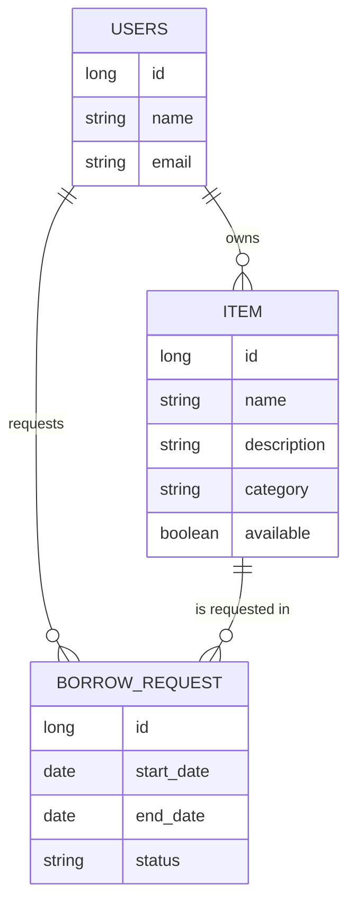

# BorrowBox

BorrowBox is a web-based community lending platform. Members list items they are willing to lend, browse and search what others have, and manage borrowing requests from approval through handover and return, all in one place.

## Problem

Borrowing things like books, calculators and lab equipment usually happens through personal messages. It is hard to know what is available, track requests, agree on dates, or make sure items come back. BorrowBox replaces that with a structured workflow and clear rules.

## Features

- **Item listings:** create, view and edit items (name, description, category, availability).
- **Search and filtering:** keyword search, category filter, and an "available only" toggle.
- **Borrow requests:** request an item for a date range.
- **Request management:** owners approve or reject requests.
- **Loan tracking:** PENDING -> APPROVED -> ACTIVE -> RETURNED (or REJECTED).
- **Overlap prevention:** an item cannot be approved for dates that overlap an approved or active loan.
- **Overdue indicator:** active loans past their end date are highlighted.
- **Persistence:** data is stored in a file-based H2 database and survives restarts.
- **Validation and permissions:** valid dates, owner-only actions and allowed status transitions are enforced on the server.

## Business rules

| Action | Rules |
|---|---|
| Create request | Both dates required; end not before start; start not in the past; item must exist and be available; you cannot borrow your own item |
| Approve | Owner only; request must be PENDING; dates must not overlap an APPROVED or ACTIVE loan for the same item |
| Reject | Owner only; request must be PENDING |
| Mark handed over | Owner only; APPROVED -> ACTIVE |
| Mark returned | Owner only; ACTIVE -> RETURNED |
| Edit item / toggle availability | Owner only |

All rules live in the service layer (`BorrowService`, `ItemService`), so they apply no matter how the UI is used.

## Technology

- Java 25 (Eclipse Temurin), Maven
- Spring Boot 4.1.1, Spring MVC
- Thymeleaf, HTML, CSS
- Spring Data JPA (Hibernate), Bean Validation
- H2 database (file mode)
- JUnit 5

## Architecture

Layered design:

```
Presentation   Thymeleaf templates (templates/*.html, static/css/style.css)
Controller     web/        ItemController, RequestController, UserController, CurrentUserAdvice, ItemForm
Service        service/    BorrowService, ItemService, BorrowRuleException
Repository     repository/ ItemRepository, UserRepository, BorrowRequestRepository
Model          model/      User, Item, BorrowRequest, RequestStatus
Config         config/     DataLoader (sample data)
```

### Data model



### Status lifecycle

```
PENDING --approve--> APPROVED --handover--> ACTIVE --return--> RETURNED
   |
   +--reject--> REJECTED
```

Overdue is not a stored status. It is derived at display time (status ACTIVE and end date before today), so no scheduled job is needed.

## Running the application

Requirements: JDK 21 or newer (developed on 25).

```bash
./mvnw spring-boot:run
```

Or run `BorrowboxApplication` from IntelliJ IDEA. Then open:

- App: http://localhost:8080/items
- Database console: http://localhost:8080/h2-console
  - JDBC URL `jdbc:h2:file:./data/borrowbox`, user `sa`, empty password

On first start, `DataLoader` creates three sample users (Asha, Ravi, Meena) and five items. Sign in with one of the demo accounts below. All three demo accounts use the shared password `Borrowbox123!` (stored as BCrypt hashes in the database).

- `asha@example.com`
- `ravi@example.com`
- `meena@example.com`

New users can register from `/register`. Use Logout to end the session.

To reset all data, stop the app and delete the `data/` folder.

## Running the tests

```bash
./mvnw test
```

Or in IntelliJ, right-click the `com.borrowbox.borrowbox` package under `src/test/java` and choose Run Tests.

There are 18 tests:

| Class | Tests | Covers |
|---|---|---|
| `BorrowboxApplicationTests` | 1 | Application context loads |
| `BorrowRequestRepositoryTest` | 3 | Relationships, lookups, overlap query |
| `BorrowServiceTest` | 9 | Date validation, own-item rule, availability, owner-only approval, overlap prevention, full lifecycle, invalid transitions |
| `ItemServiceTest` | 5 | Owner-only edit and availability toggle, missing item |

Tests use an in-memory H2 database and run inside rolled-back transactions, so they never touch the real `data/` folder. Test users use `@test.example` emails to avoid colliding with the sample data.

## Known limitations

- Authentication uses server-side HTTP sessions and BCrypt password hashes. This is a simple project login, not a full production identity system; production deployment should add CSRF protection, rate limiting, secure cookie settings over HTTPS, and a more complete security review.
- Marking an item unavailable only blocks new requests; existing approved or active loans are unaffected.
- The overlap check is not protected against two owners approving conflicting requests at the same instant. A database-level lock or constraint would be needed for production.
- Borrowers cannot cancel their own requests, and items cannot be deleted.
- No web-layer (MockMvc) tests; the business rules are covered at the service and repository level.
- The dev setup uses `ddl-auto=update` and H2; a production deployment would use a managed database and migrations.

## Future enhancements

Email notifications, overdue reminders, user ratings, item images, request cancellation, role-based access controls, deployment, and analytics on community sharing.
